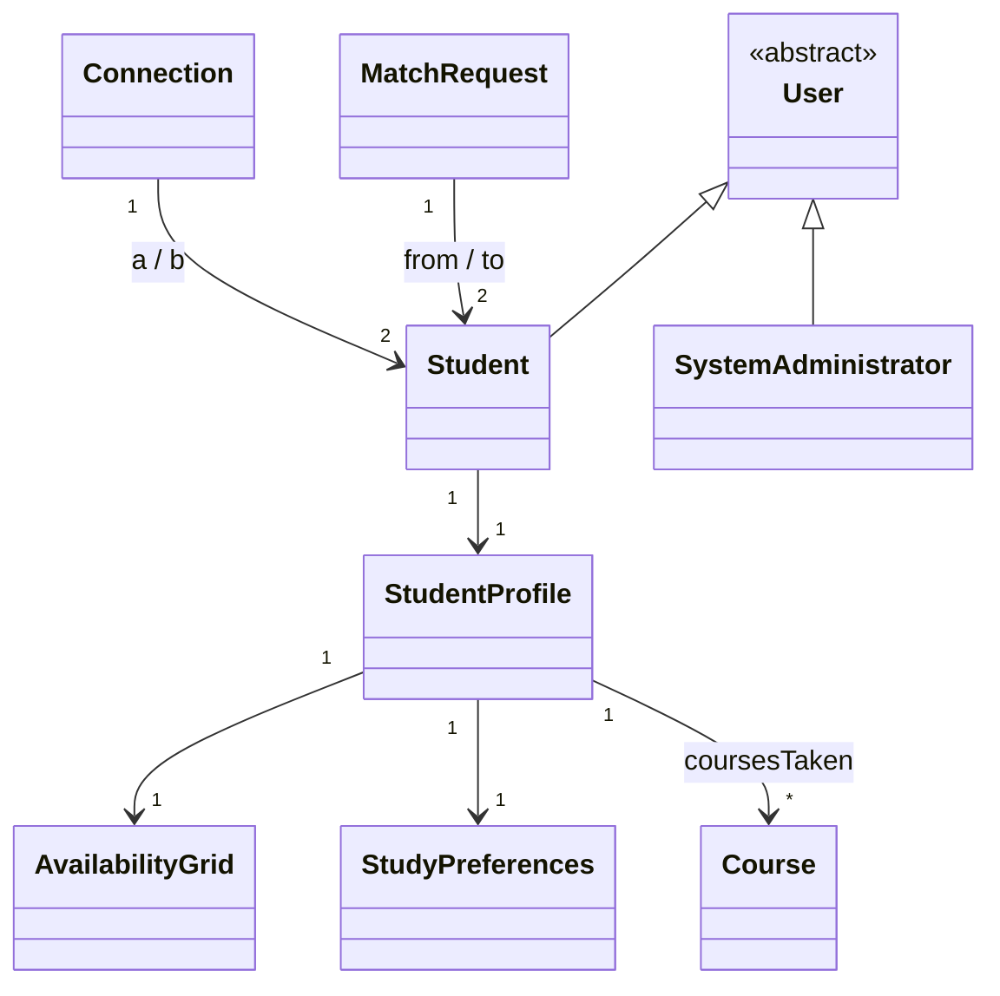
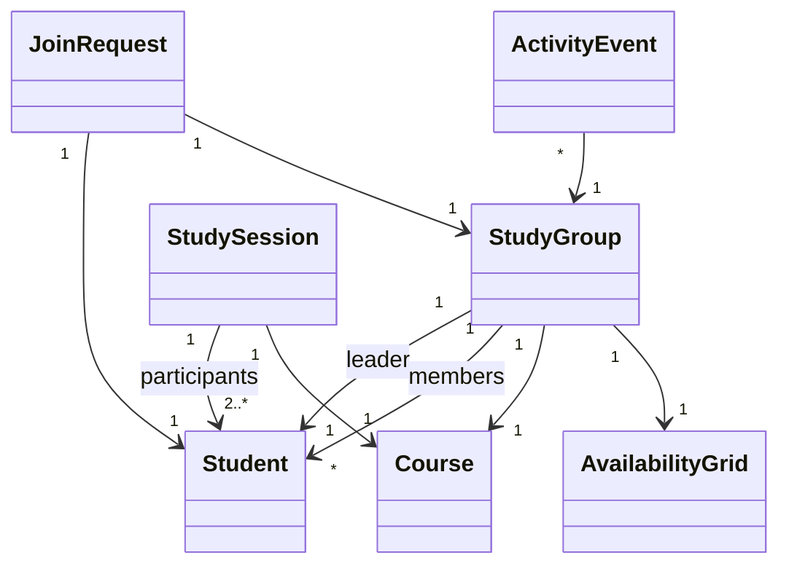
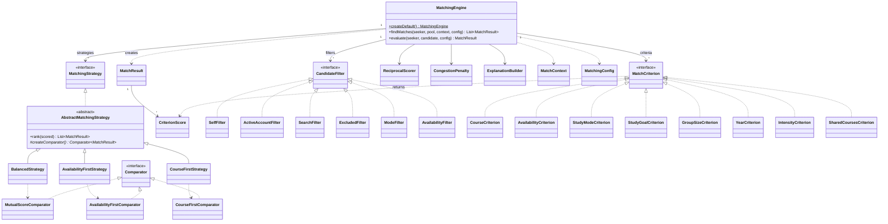
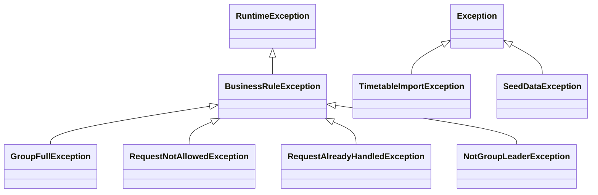
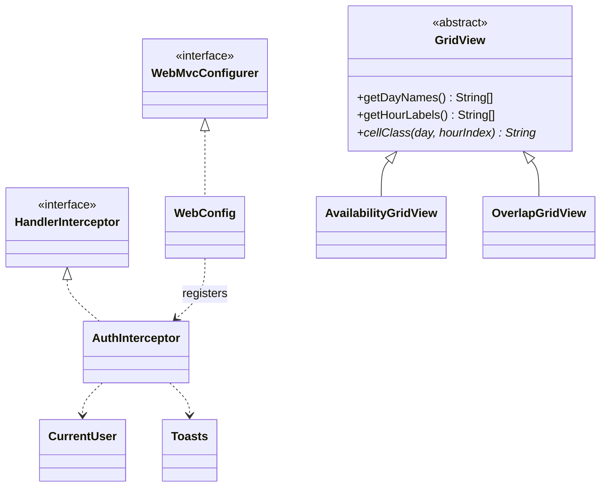
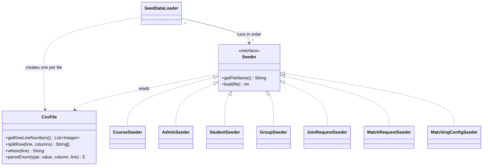

# Doc 0 — Foundation (Study Buddy Matcher)


What this doc contains: how the project is layered, the naming rules, every shared class with its fields, the class diagram, and one complete worked example (Course) that shows the pattern every feature follows.

---

## 1. The four layers

Every feature is built as four small pieces, top to bottom:

```
controller/   receives the web request, calls a service, returns a page name
service/      the business rules (matching, capacity checks, status changes)
repository/   stores and finds objects (in-memory HashMap, no database)
model/        the plain classes: Student, Course, StudyGroup, ...
```

Rules:
- A controller never contains business logic. It calls a service.
- A service never builds HTML. It returns objects.
- Only repositories hold data. Services ask repositories; they do not keep their own maps.
- Model classes know nothing about Spring, web, or repositories. They are plain Java.

Why: this is the "layered to known design principles" line in the rubric, and it is what lets seven people work without stepping on each other.

## 2. Packages and naming

Base package: `com.studybuddy`

```
com.studybuddy.model         entities + enums
com.studybuddy.repository    repository interfaces + InMemory implementations
com.studybuddy.service       services
com.studybuddy.controller    controllers
com.studybuddy.engine        matching: engine, config, results (+ filter, criteria, strategy sub-packages)
com.studybuddy.importer      timetable import: reads a timetable file into class hours
com.studybuddy.seed          seed data: SeedDataLoader runs one Seeder per CSV file
src/main/resources/templates/   Thymeleaf pages (.html)
src/main/resources/static/      css, the one js file
```

`model`, `engine` and `importer` are plain Java: nothing in them imports `org.springframework.*` or `jakarta.*`.

Naming (Java Coding Conventions — these are graded):
- Classes `PascalCase`, methods/fields `camelCase`, constants `UPPER_SNAKE`.
- Repository interfaces: `StudentRepository`; implementations: `InMemoryStudentRepository`.
- Booleans read as questions: `isOpen()`, `hasCapacity()`.
- Every class and every public method gets a Javadoc comment: `/** One line saying what it is responsible for. */` The API reference site is generated from these (`mvn javadoc:javadoc`), like the pages from the Week 2 ICE.

## 3. The shared classes (the spine)

Field-level definitions. Methods are only listed where they are part of the shared contract; everything else each sub-team designs in its own territory doc.

Rules every entity follows: `equals`/`hashCode` compare by id (`User` and its subclasses, `StudyGroup`, `JoinRequest`, `MatchRequest`, `Connection`, `StudySession`) or by code (`Course`); a getter for an entity's own collection returns a read-only view and the matching setter copies its argument, so a collection only changes through its owner's methods (`StudyGroup.addMember`); goal sets are `EnumSet`s, so they always list in declaration order.

### Users

```java
/** Anyone with an account. Abstract: you are either a Student or an Administrator. */
public abstract class User {
    private final String id;
    private String name;
    private String email;
    private AccountStatus status;      // ACTIVE, SUSPENDED

    /** "Student" or "Administrator". The picker and nav use this instead of instanceof. */
    public abstract String getRoleLabel();
}

/** A student. Extends User. Leadership of a group is NOT a subclass —
    a leader is just the Student that a StudyGroup points at. */
public class Student extends User {
    private StudentProfile profile;
}

/** The system administrator. Extends User. */
public class SystemAdministrator extends User {
}
```

### Profile

```java
/** A student's study-facing data. Account identity lives on User; this is what gets matched. */
public class StudentProfile {
    private String school;
    private String programme;
    private int yearOfStudy;
    private String contactNumber;              // PRIVATE. No getter. See views below.
    private List<Course> coursesTaken;         // current courses (worksheet import fills this)
    private List<Course> completedCourses;     // display + discovery panel only, never scored
    private StudyPreferences preferences;
    private AvailabilityGrid availability;
    private String lookingFor;                 // free text shown on match cards

    /** Profile as strangers see it: contactNumber is omitted. */
    public ProfileView toPublicView() { ... }

    /** Profile as an accepted connection sees it: contactNumber included. */
    public ProfileView toConnectedView() { ... }
}

/** What a student wants in a buddy. */
public class StudyPreferences {
    private Course targetCourse;               // the course they need a buddy for
    private StudyMode mode;
    private GroupFormat format;
    private Set<StudyGoal> goals;
    private Intensity intensity;
}
```

The contact number rule is the brief's "hidden until a match is accepted" requirement, enforced by the class itself: there is no way to read the field except through `toConnectedView()`, and only the service calls that, after checking the connection. Do not add a getter.

### Availability

```java
/** A student's weekly availability: 7 days x 15 hourly cells (08:00-23:00). */
public class AvailabilityGrid {
    public static final int DAYS = 7;              // the ONLY place the grid's shape is written down
    public static final int HOURS_PER_DAY = 15;
    public static final int FIRST_HOUR = 8;
    public static final int LAST_HOUR = 23;
    private final boolean[][] cells = new boolean[DAYS][HOURS_PER_DAY];   // [day][hourIndex]

    public static String dayName(int day) { ... }       // 0 -> "MON" ... 6 -> "SUN"
    public static int dayIndex(String name) { ... }     // "MON" -> 0; IllegalArgumentException otherwise

    public boolean isAvailable(int day, int hourIndex) { ... }
    public void set(int day, int hourIndex, boolean available) { ... }

    /** Hours per week where BOTH grids are true. Used by matching, the overlap visual,
        the group heatmap, and best-slot. */
    public int overlapHours(AvailabilityGrid other) { ... }

    /** Every run of consecutive hours where BOTH grids are free, on the same day, of length
        >= minHours, in day then hour order. Used by matching and best-slot suggestions. */
    public List<TimeBlock> commonBlocks(AvailabilityGrid other, int minHours) { ... }

    /** The total length of commonBlocks(other, minHours): hours you could actually hold a session in. */
    public int usableHours(AvailabilityGrid other, int minHours) { ... }

    /** Builds a grid from text like "MON 19-21;WED 19-21;SAT 14-18" (end hour exclusive,
        so 19-21 marks 19:00 and 20:00). Blank text gives an empty grid. Throws
        IllegalArgumentException for a bad day, a range outside 8..23, or start >= end. */
    public static AvailabilityGrid parse(String text) { ... }
}
```

One structure, four features. Day 0 = Monday. Hour index 0 = 08:00. Used by both students (`StudentProfile.availability`) and groups (`StudyGroup.availability`).

```java
/** A run of whole hours on one day, e.g. Wednesday 19:00 to 21:00. Immutable. */
public class TimeBlock {
    private final int day;         // 0 = Monday
    private final int startHour;   // clock hour, e.g. 19
    private final int endHour;     // clock hour, exclusive, e.g. 21

    public int getLength() { ... }        // endHour - startHour
    public String toString() { ... }      // "WED 19-21"
}
```

### Course

```java
/** A course students can be matched on. We seed exactly 10. */
public class Course {
    private final String code;      // "IS442"
    private final String title;     // "Object-Oriented Programming"
    private final String school;    // "SCIS"
}
```

### Between two students

```java
/** A buddy request from one student to another. */
public class MatchRequest {
    private final String id;
    private final Student from;
    private final Student to;
    private String message;             // optional
    private RequestStatus status;       // PENDING -> ACCEPTED or DECLINED

    public void accept() { ... }        // both throw RequestAlreadyHandledException("This request was already handled")
    public void decline() { ... }       // unless PENDING; there is no setStatus
}

/** Recorded when a student clicks Pass on Find Buddies; the candidate is hidden from that student's future results. */
public class Pass {
    private final Student seeker;
    private final Student candidate;
    private final LocalDate date;
}

/** Thrown when the rules refuse a buddy request (already pending, already connected, ...). */
public class RequestNotAllowedException extends BusinessRuleException { }

/** An accepted match. While active, each side may see the other's connected view. */
public class Connection {
    private final String id;
    private final Student a;
    private final Student b;
    private final LocalDate since;
    private boolean active;             // end connection = set false
}
```

### Groups (Leader team's entities — frozen at field level, behaviour is yours)

```java
/** A standing many-person match for one course. The page around it is a
    coordination dashboard: heatmap, sessions, feed. Never a chat. */
public class StudyGroup {
    private final String id;
    private String name;
    private String description;
    private Course course;
    private Student leader;             // the role, held by reference
    private List<Student> members;
    private int maxSize;
    private Visibility visibility;      // PUBLIC or PRIVATE
    private Set<StudyGoal> goals;
    private StudyMode mode;
    private boolean open;               // closed groups accept nobody
    private AvailabilityGrid availability;   // the group's weekly availability (the brief requires it)
}

/** A request by a student to join a group. Same lifecycle as MatchRequest. */
public class JoinRequest {
    private final String id;
    private final Student student;
    private final StudyGroup group;
    private RequestStatus status;
}

/** One row of a group's activity feed. Generated by the system from real actions
    (joined, proposed, confirmed). Never typed by a user. */
public class ActivityEvent {
    private final StudyGroup group;
    private final ActivityType type;
    private final String text;
    private final LocalDateTime timestamp;
}

/** A planned meeting. Works for 2 buddies (from a Connection) or a whole group:
    a session belongs to its participants, not to the group. */
public class StudySession {
    private final String id;
    private Course course;
    private int day;                    // grid coordinates
    private int startHour;
    private int endHour;
    private String location;
    private List<Student> participants;
    private Map<Student, Rsvp> rsvps;   // GOING / CANT
    private SessionStatus status;       // PROPOSED -> CONFIRMED -> PAST
}
```

### Enums (fixed value sets)

```java
public enum AccountStatus { ACTIVE, SUSPENDED }
public enum StudyMode     { IN_PERSON, ONLINE, EITHER }
public enum GroupFormat   { ONE_TO_ONE, SMALL_GROUP, EITHER }
public enum StudyGoal     { CONCEPT_REVIEW, PROBLEM_SOLVING, EXAM_PREP, PROJECT_DISCUSSION }
public enum Intensity     { CASUAL, STEADY, GRIND }
public enum RequestStatus { PENDING, ACCEPTED, DECLINED }
public enum SessionStatus { PROPOSED, CONFIRMED, PAST }
public enum Visibility    { PUBLIC, PRIVATE }
public enum Rsvp          { GOING, CANT }
public enum ActivityType  { MEMBER_JOINED, MEMBER_LEFT, SESSION_PROPOSED, SESSION_CONFIRMED, LEADERSHIP_TRANSFERRED }
```

`Role`, `StudyMode`, `GroupFormat`, `StudyGoal`, `Intensity` and `Visibility` carry the text shown to people: `getLabel()` (`StudyMode.EITHER` is "In person or online"), used in templates as `${x.label}`. Each also has `public static X fromName(String text)`, which returns the constant whose `name()` is exactly the text, or null for null, blank or unknown text; services use it to read form values.

### The matching engine (Student team's territory)

The engine is plain Java in `com.studybuddy.engine` and its sub-packages `filter`, `criteria` and `strategy`. The types below are the contract the services and the admin config page call; how it all fits together is in `docs/MATCHING_ENGINE.md`.

```java
/** One criterion's verdict on a pair: 0.0 to 1.0, plus a reason (null when nothing worth saying). */
public class CriterionScore {
    private final double value;     // constructor throws IllegalArgumentException outside 0..1
    private final String reason;
}

/** One scoring rule. One class per criterion. */
public interface MatchCriterion {
    String getName();                                        // "availability" — the config key
    String getLabel();                                       // "Availability" — shown to people
    CriterionScore score(StudentProfile seeker, StudentProfile candidate, MatchingConfig config);  // seeker's side only
}

/** A dealbreaker check, applied before scoring. */
public interface CandidateFilter {
    String getName();
    boolean accepts(Student seeker, Student candidate, MatchContext context, MatchingConfig config);
}

/** One search's details, built by the service. Immutable. */
public class MatchContext {
    private final String courseCode;                     // nullable
    private final StudyGoal goal;                        // nullable
    private final StudyMode mode;                        // nullable; null or EITHER = any mode
    private final int minUsableHours;                    // 0 = no limit
    private final Set<String> excludedIds;
    private final Map<String, Integer> pendingIncoming;  // candidate id -> PENDING requests received
}

/** One way of ordering scored results (package com.studybuddy.engine.strategy). */
public interface MatchingStrategy {
    String getName();                                        // "balanced" — the config key
    String getLabel();                                       // "Balanced"
    String getDescription();                                 // "Every criterion counts by its weight." (config page legend)
    List<MatchResult> rank(List<MatchResult> scored);        // returns a new sorted list
}

/** The admin's settings: which strategy, which criteria on, what weights. MatchingConfig.defaults() gives the starting values. */
public class MatchingConfig {
    private String activeStrategyName;
    private Set<String> enabledCriteria;
    private Map<String, Double> weights;      // criterion name -> weight
    private int maxResults;
    private double minimumScore;
    private int targetUsableHours;            // usable hours that earn a full availability score (4)
    private int minSessionHours;              // shortest shared block that counts (2)
    private double congestionStrength;        // how much each pending request lowers a score (0.05)
}

/** One row of a ranked result. Immutable; the map and list are read-only copies. */
public class MatchResult {
    private final Student candidate;
    private final double mutualScore;                          // after congestion
    private final double fitForSeeker;
    private final double fitForCandidate;
    private final Map<String, CriterionScore> criterionScores; // seeker side; drives the score bars
    private final int usableHours;
    private final int pendingRequests;
    private final List<String> reasons;
}

/** Runs the pipeline. MatchingEngine.createDefault() assembles the 6 filters, 8 criteria and 3 strategies. */
public class MatchingEngine {
    public List<MatchResult> findMatches(Student seeker, List<Student> pool, MatchContext context, MatchingConfig config);
    public MatchResult evaluate(Student seeker, Student candidate, MatchingConfig config);   // one pair: no filters, congestion or cut
    public List<String> getCriterionNames();
    public List<String> getStrategyNames();
    public String getCriterionLabel(String name);
    public String getStrategyLabel(String name);
}
```

### My profile and timetable import (Student team's territory)

The importer is plain Java in `com.studybuddy.importer`; how it reads a file is in `docs/TIMETABLE_IMPORT.md`.

```java
/** Reads one kind of timetable file. B3b adds ScreenshotTimetableImporter behind this same interface. */
public interface TimetableImporter {
    String getName();                                        // "ics"
    boolean supports(String fileName);                       // by extension, case-insensitive
    TimetableImport read(InputStream input) throws TimetableImportException;
}

/** What an import found. Immutable: the grid and lists are copies. */
public class TimetableImport {
    private final AvailabilityGrid busy;        // true = in class
    private final List<String> classNames;      // distinct, first-seen order
    private final int classCount;               // distinct weekly (day, start, end) slots
    private final List<String> warnings;        // skipped or clipped entries
}

/** Thrown when an uploaded timetable cannot be read. Checked. */
public class TimetableImportException extends Exception { }

/** Reads an .ics calendar export (RFC 5545). The only class allowed to use java.time. */
public class IcsTimetableImporter implements TimetableImporter { }
```

In `com.studybuddy.service`:

```java
/** Raw values from the edit-profile form, all as text. from(profile) prefills it (contact left blank). */
public class ProfileForm {
    private String school, programme, year, newContactNumber;   // blank contact = keep the current one
    private List<String> currentCourseCodes, completedCourseCodes, goals;
    private String targetCourseCode, mode, format, intensity, lookingFor;
}

/** A student editing their OWN profile. ProfileService keeps the viewing rules. */
@Service
public class ProfileEditService {
    public Map<String, String> validate(ProfileForm form);              // field name -> message
    public void update(Student student, ProfileForm form);
    public void updateAvailability(Student student, List<String> cells); // "day-hourIndex", e.g. "2-11"
    public boolean needsAvailability(Student student);                   // drives the Home banner
}

/** Turns an uploaded timetable into a DRAFT grid; saves nothing. */
@Service
public class TimetableImportService {
    public TimetableImport importTimetable(String fileName, InputStream input) throws TimetableImportException;
    public AvailabilityGrid draftFrom(TimetableImport imported);         // every non-class hour ticked
}
```

`ProfileService.ownView(student)` returns the student's own profile through `toConnectedView()`, so My profile can show their own contact number without a getter.

## 4. Class diagram

Small diagrams instead of one tangle. A to C also live in the repo as `docs/diagram-users.mmd`, `docs/diagram-groups.mmd`, `docs/diagram-engine.mmd` (Mermaid renders on GitHub automatically); D to F cover the cross-cutting pieces.

**A — Users and matching entities:**



**B — Groups and sessions:**



**C — The matching engine:**



**D — Rule violations: one exception hierarchy.** A `BusinessRuleException` means an action broke a rule of the system (joining a closed group, answering a request twice), not a programming error. Services and entities throw it, or a subclass when some caller needs to tell that rule apart, with a message written for people. Controllers catch `BusinessRuleException` and show the message as an error toast. The two checked exceptions stay separate: they are about unreadable files, not rules.



**E — Web layer helpers (controller package).** `AuthInterceptor` runs before every page except the picker, sign-in, sign-out, static files, the error page and bare `/admin` (which only redirects to `/admin/users`). It redirects to `/` when nobody is signed in or the user no longer exists, signs out a suspended user with the toast "This account is suspended", and keeps everyone but administrators out of `/admin/...`. `WebConfig` registers it. A check every page needs is a cross-cutting concern, so it lives in one class instead of in every controller. `GridView` holds what every page grid shares (row and column labels, by inheritance); each subclass decides how a cell looks.



**F — Seed data.** `SeedDataLoader` (the only `@Component`) builds one `Seeder` per CSV file, each with only the repositories it needs, and runs them in order (courses, admins, students, groups, join requests, match requests, matching config), because each file refers to the ones before it. `CsvFile` reads one file from the classpath, gives its data rows by line number, and holds the cell parsers; every error names the file and line, e.g. "students.csv line 3: unknown mode 'FLYING'".



Read them like the Week 3 slides: hollow-triangle arrows are `extends`/`implements`; plain arrows are "has a reference to"; dotted arrows are "uses"; numbers are multiplicity. Diagram C shows the whole engine; `docs/MATCHING_ENGINE.md` explains it.

## 5. Repositories (shared contract)

"Repository" is not a Java feature and is not taught in class — it is a design pattern built from two things we do learn: an **interface** (Week 4) and a **HashMap** (Week 10, one of our known run-aheads). The idea: one class whose only job is storing and finding one type of object, hidden behind an interface so the rest of the app never knows or cares HOW things are stored. That split is also our polymorphism demonstration at the storage layer.

One interface per entity that needs storing. Finder methods return the object, or `null` if not found — check for null before using. Pattern:

```java
/** Stores and finds students. The rest of the app only ever sees this interface. */
public interface StudentRepository {
    void save(Student student);
    Student findById(String id);        // null if no such student
    List<Student> findAll();
}

public class InMemoryStudentRepository implements StudentRepository {
    private final Map<String, Student> store = new HashMap<>();
    // ...
}
```

Same shape for Course, SystemAdministrator (`SystemAdministratorRepository`), MatchRequest, Connection, StudyGroup, JoinRequest, StudySession, ActivityEvent, Pass. The Student, Course and SystemAdministrator implementations use a `LinkedHashMap`, which keeps insertion order, so `findAll()` returns rows in seed CSV order. Add finder methods your feature needs (`findByCourse(...)`) to your own repository interface — that is normal and does not need a spine change.

Shared finders other teams rely on:

```java
// MatchRequestRepository
String nextId();                                   // "R001", "R002", ...
List<MatchRequest> findFrom(String studentId);     // any status, saved order
List<MatchRequest> findTo(String studentId);       // any status, saved order

// ConnectionRepository
List<Connection> findActiveFor(String studentId);  // active, student is a or b

// PassRepository (list-backed, like ActivityEvent)
void save(Pass pass);
List<Pass> findBySeeker(String seekerId);
boolean delete(String seekerId, String candidateId);
```

## 6. The worked example: Course, all four layers

This is the template. Every feature in Docs 1–3 is this pattern with different nouns.

Concepts it uses and where they come from: classes/fields/constructors (Wk2), interface + implements (Wk4), HashMap and List (Wk10 — known run-ahead), `@Service`/`@Controller`/`@GetMapping` and constructor injection (Spring — never taught; this is our capped framework footprint, covered in the 45-min team walkthrough), Thymeleaf `th:each`/`th:text` (never taught; it is HTML plus five attributes). Nothing else.

**Model** — `com.studybuddy.model.Course` (shown in section 3).

**Repository** — `com.studybuddy.repository`:

```java
/** Stores and finds courses. */
public interface CourseRepository {
    void save(Course course);
    Course findByCode(String code);     // null if no such course
    List<Course> findAll();
}

/** HashMap-backed implementation. */
public class InMemoryCourseRepository implements CourseRepository {

    private final Map<String, Course> store = new HashMap<>();

    @Override
    public void save(Course course) {
        store.put(course.getCode(), course);
    }

    @Override
    public Course findByCode(String code) {
        return store.get(code);         // HashMap returns null if the key is absent
    }

    @Override
    public List<Course> findAll() {
        return new ArrayList<>(store.values());
    }
}
```

**Service** — `com.studybuddy.service`:

```java
/** Business rules around courses. Thin for now; grows if rules appear. */
@Service
public class CourseService {

    private final CourseRepository courseRepository;

    public CourseService(CourseRepository courseRepository) {   // constructor injection
        this.courseRepository = courseRepository;
    }

    public List<Course> findAll() {
        return courseRepository.findAll();
    }
}
```

**Controller + page** — `com.studybuddy.controller`:

```java
/** Pages about courses. */
@Controller
public class CourseController {

    private final CourseService courseService;

    public CourseController(CourseService courseService) {
        this.courseService = courseService;
    }

    @GetMapping("/courses")
    public String showCourses(Model model) {
        model.addAttribute("courses", courseService.findAll());
        return "courses";                    // -> templates/courses.html
    }
}
```

`templates/courses.html`:

```html
<table>
  <tr><th>Code</th><th>Title</th><th>School</th></tr>
  <tr th:each="c : ${courses}">
    <td th:text="${c.code}">IS442</td>
    <td th:text="${c.title}">Object-Oriented Programming</td>
    <td th:text="${c.school}">SCIS</td>
  </tr>
</table>
```

That is a complete feature: model → repository → service → controller → page. When you build "group join requests" or "admin user table", write these same four pieces with your nouns.
