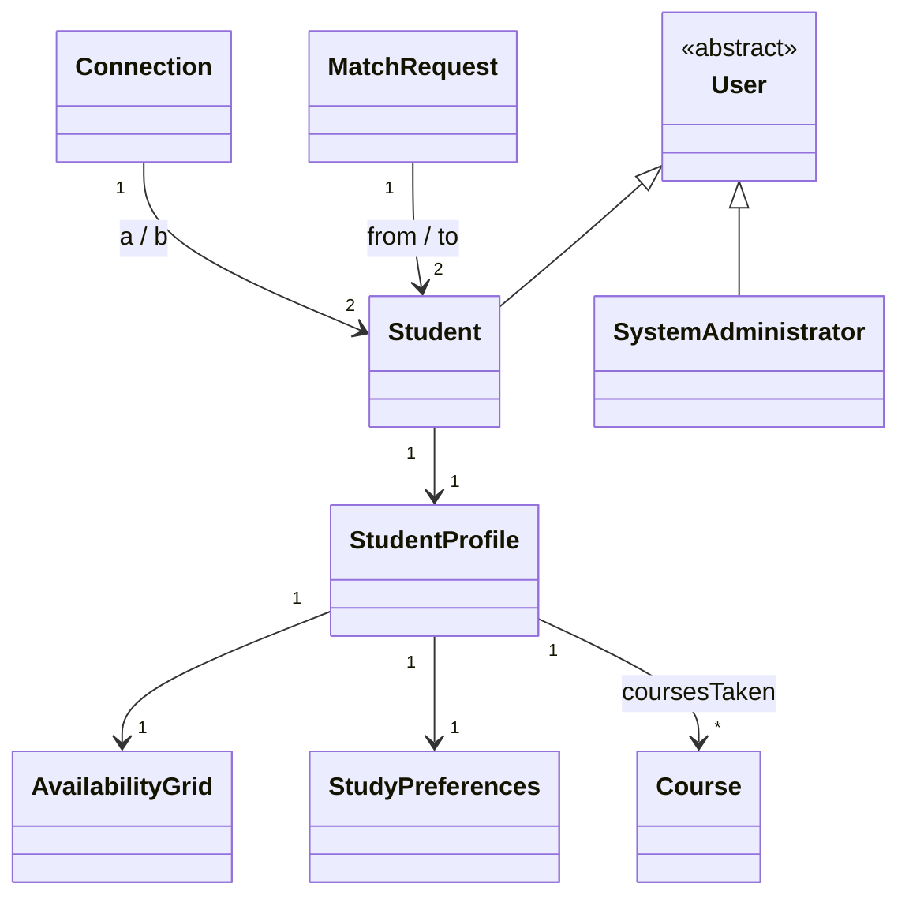
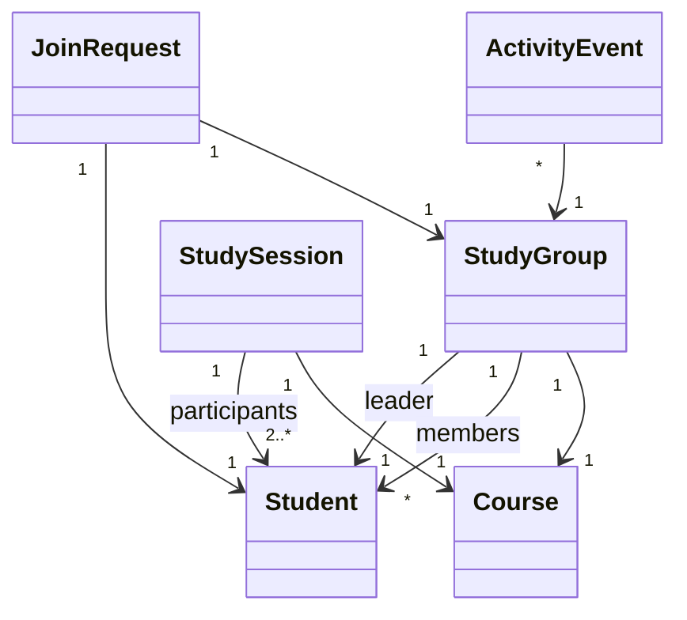
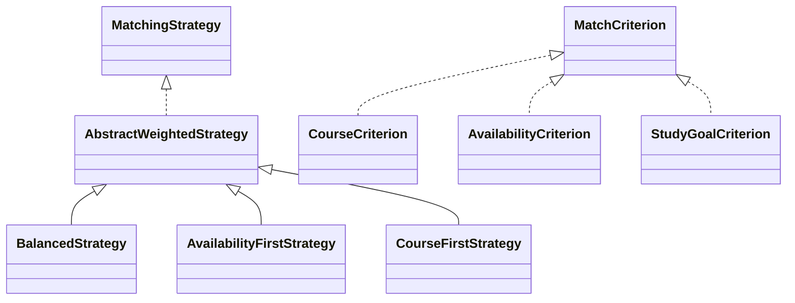

# Doc 0 — Foundation (Study Buddy Matcher)


What this doc contains: how the project is layered, the naming rules, every shared class with its fields, the class diagram, and one complete worked example (Course) that shows the pattern every feature follows.

---

## 1. The four layers

Every feature is built as four small pieces, top to bottom:

```
controller/   receives the web request, calls a service, returns a page name
service/      the business rules (matching, capacity checks, status changes)
repository/   stores and finds objects (in-memory HashMap, no database)
model/        the plain classes: Student, Course, StudyGroup, ...
```

Rules:
- A controller never contains business logic. It calls a service.
- A service never builds HTML. It returns objects.
- Only repositories hold data. Services ask repositories; they do not keep their own maps.
- Model classes know nothing about Spring, web, or repositories. They are plain Java.

Why: this is the "layered to known design principles" line in the rubric, and it is what lets seven people work without stepping on each other.

## 2. Packages and naming

Base package: `com.studybuddy`

```
com.studybuddy.model         entities + enums
com.studybuddy.repository    repository interfaces + InMemory implementations
com.studybuddy.service       services
com.studybuddy.controller    controllers
com.studybuddy.engine        matching: criteria, strategies, config, results
com.studybuddy.seed          seed data loaders
src/main/resources/templates/   Thymeleaf pages (.html)
src/main/resources/static/      css, the one js file
```

Naming (Java Coding Conventions — these are graded):
- Classes `PascalCase`, methods/fields `camelCase`, constants `UPPER_SNAKE`.
- Repository interfaces: `StudentRepository`; implementations: `InMemoryStudentRepository`.
- Booleans read as questions: `isOpen()`, `hasCapacity()`.
- Every class and every public method gets a Javadoc comment: `/** One line saying what it is responsible for. */` The API reference site is generated from these (`mvn javadoc:javadoc`), like the pages from the Week 2 ICE.

## 3. The shared classes (the spine)

Field-level definitions. Methods are only listed where they are part of the shared contract; everything else each sub-team designs in its own territory doc.

### Users

```java
/** Anyone with an account. Abstract: you are either a Student or an Administrator. */
public abstract class User {
    private final String id;
    private String name;
    private String email;
    private AccountStatus status;      // ACTIVE, SUSPENDED
}

/** A student. Extends User. Leadership of a group is NOT a subclass —
    a leader is just the Student that a StudyGroup points at. */
public class Student extends User {
    private StudentProfile profile;
}

/** The system administrator. Extends User. */
public class SystemAdministrator extends User {
}
```

### Profile

```java
/** A student's study-facing data. Account identity lives on User; this is what gets matched. */
public class StudentProfile {
    private String school;
    private String programme;
    private int yearOfStudy;
    private String contactNumber;              // PRIVATE. No getter. See views below.
    private List<Course> coursesTaken;         // current courses (worksheet import fills this)
    private List<Course> completedCourses;     // display + discovery panel only, never scored
    private StudyPreferences preferences;
    private AvailabilityGrid availability;
    private String lookingFor;                 // free text shown on match cards

    /** Profile as strangers see it: contactNumber is omitted. */
    public ProfileView toPublicView() { ... }

    /** Profile as an accepted connection sees it: contactNumber included. */
    public ProfileView toConnectedView() { ... }
}

/** What a student wants in a buddy. */
public class StudyPreferences {
    private Course targetCourse;               // the course they need a buddy for
    private StudyMode mode;
    private GroupFormat format;
    private Set<StudyGoal> goals;
    private Intensity intensity;
}
```

The contact number rule is the brief's "hidden until a match is accepted" requirement, enforced by the class itself: there is no way to read the field except through `toConnectedView()`, and only the service calls that, after checking the connection. Do not add a getter.

### Availability

```java
/** A student's weekly availability: 7 days x 15 hourly cells (08:00-23:00). */
public class AvailabilityGrid {
    private final boolean[][] cells = new boolean[7][15];   // [day][hourIndex]

    public boolean isAvailable(int day, int hourIndex) { ... }
    public void set(int day, int hourIndex, boolean available) { ... }

    /** Hours per week where BOTH grids are true. Used by matching, the overlap visual,
        the group heatmap, and best-slot. */
    public int overlapHours(AvailabilityGrid other) { ... }
}
```

One structure, four features. Day 0 = Monday. Hour index 0 = 08:00.

### Course

```java
/** A course students can be matched on. We seed exactly 10. */
public class Course {
    private final String code;      // "IS442"
    private final String title;     // "Object-Oriented Programming"
    private final String school;    // "SCIS"
}
```

### Between two students

```java
/** A buddy request from one student to another. */
public class MatchRequest {
    private final String id;
    private final Student from;
    private final Student to;
    private String message;             // optional
    private RequestStatus status;       // PENDING -> ACCEPTED or DECLINED
}

/** An accepted match. While active, each side may see the other's connected view. */
public class Connection {
    private final String id;
    private final Student a;
    private final Student b;
    private final LocalDate since;
    private boolean active;             // end connection = set false
}
```

### Groups (Leader team's entities — frozen at field level, behaviour is yours)

```java
/** A standing many-person match for one course. The page around it is a
    coordination dashboard: heatmap, sessions, feed. Never a chat. */
public class StudyGroup {
    private final String id;
    private String name;
    private String description;
    private Course course;
    private Student leader;             // the role, held by reference
    private List<Student> members;
    private int maxSize;
    private Visibility visibility;      // PUBLIC or PRIVATE
    private Set<StudyGoal> goals;
    private StudyMode mode;
    private boolean open;               // closed groups accept nobody
}

/** A request by a student to join a group. Same lifecycle as MatchRequest. */
public class JoinRequest {
    private final String id;
    private final Student student;
    private final StudyGroup group;
    private RequestStatus status;
}

/** One row of a group's activity feed. Generated by the system from real actions
    (joined, proposed, confirmed). Never typed by a user. */
public class ActivityEvent {
    private final StudyGroup group;
    private final ActivityType type;
    private final String text;
    private final LocalDateTime timestamp;
}

/** A planned meeting. Works for 2 buddies (from a Connection) or a whole group:
    a session belongs to its participants, not to the group. */
public class StudySession {
    private final String id;
    private Course course;
    private int day;                    // grid coordinates
    private int startHour;
    private int endHour;
    private String location;
    private List<Student> participants;
    private Map<Student, Rsvp> rsvps;   // GOING / CANT
    private SessionStatus status;       // PROPOSED -> CONFIRMED -> PAST
}
```

### Enums (fixed value sets)

```java
public enum AccountStatus { ACTIVE, SUSPENDED }
public enum StudyMode     { IN_PERSON, ONLINE, EITHER }
public enum GroupFormat   { ONE_TO_ONE, SMALL_GROUP, EITHER }
public enum StudyGoal     { CONCEPT_REVIEW, PROBLEM_SOLVING, EXAM_PREP, PROJECT_DISCUSSION }
public enum Intensity     { CASUAL, STEADY, GRIND }
public enum RequestStatus { PENDING, ACCEPTED, DECLINED }
public enum SessionStatus { PROPOSED, CONFIRMED, PAST }
public enum Visibility    { PUBLIC, PRIVATE }
public enum Rsvp          { GOING, CANT }
public enum ActivityType  { MEMBER_JOINED, MEMBER_LEFT, SESSION_PROPOSED, SESSION_CONFIRMED, LEADERSHIP_TRANSFERRED }
```

### The matching engine (Student team's territory)

Only the two interfaces and the two data classes below are frozen — and only because the Admin team's config screen must call something stable. Everything inside (the eight criterion classes, how each strategy actually ranks) is Student-team design work, done after the Week 4 interfaces lecture, and documented in Doc 1.

```java
/** One scoring rule. One class per criterion. Returns 0.0 (no fit) to 1.0 (perfect). */
public interface MatchCriterion {
    String getName();                                        // "availability" — used as the config key
    double score(StudentProfile a, StudentProfile b);
}

/** One way of combining criterion scores into a ranking. */
public interface MatchingStrategy {
    String getName();                                        // "balanced" — used as the config key
    List<MatchResult> rank(StudentProfile seeker, List<Student> candidates, MatchingConfig config);
}

/** The admin's settings: which strategy, which criteria on, what weights. */
public class MatchingConfig {
    private String activeStrategyName;
    private Set<String> enabledCriteria;
    private Map<String, Double> weights;      // criterion name -> weight
    private int maxResults;
    private double minimumScore;
}

/** One row of a ranked result: who, the total, and the per-criterion breakdown
    (the breakdown is what the score bars on screen are drawn from). */
public class MatchResult {
    private final Student candidate;
    private final double totalScore;
    private final Map<String, Double> criterionScores;
}
```

## 4. Class diagram

Three small diagrams instead of one tangle. They live in the repo as `docs/diagram-users.mmd`, `docs/diagram-groups.mmd`, `docs/diagram-engine.mmd` (Mermaid renders on GitHub automatically).

**A — Users and matching entities:**



**B — Groups and sessions:**



**C — The matching engine:**



Read them like the Week 3 slides: hollow-triangle arrows are `extends`/`implements`; plain arrows are "has a reference to"; numbers are multiplicity. Diagram C shows three of the eight criterion classes; the full set is Doc 1's job.

## 5. Repositories (shared contract)

"Repository" is not a Java feature and is not taught in class — it is a design pattern built from two things we do learn: an **interface** (Week 4) and a **HashMap** (Week 10, one of our known run-aheads). The idea: one class whose only job is storing and finding one type of object, hidden behind an interface so the rest of the app never knows or cares HOW things are stored. That split is also our polymorphism demonstration at the storage layer.

One interface per entity that needs storing. Finder methods return the object, or `null` if not found — check for null before using. Pattern:

```java
/** Stores and finds students. The rest of the app only ever sees this interface. */
public interface StudentRepository {
    void save(Student student);
    Student findById(String id);        // null if no such student
    List<Student> findAll();
}

public class InMemoryStudentRepository implements StudentRepository {
    private final Map<String, Student> store = new HashMap<>();
    // ...
}
```

Same shape for Course, MatchRequest, Connection, StudyGroup, JoinRequest, StudySession, ActivityEvent. Add finder methods your feature needs (`findByCourse(...)`) to your own repository interface — that is normal and does not need a spine change.

## 6. The worked example: Course, all four layers

This is the template. Every feature in Docs 1–3 is this pattern with different nouns.

Concepts it uses and where they come from: classes/fields/constructors (Wk2), interface + implements (Wk4), HashMap and List (Wk10 — known run-ahead), `@Service`/`@Controller`/`@GetMapping` and constructor injection (Spring — never taught; this is our capped framework footprint, covered in the 45-min team walkthrough), Thymeleaf `th:each`/`th:text` (never taught; it is HTML plus five attributes). Nothing else.

**Model** — `com.studybuddy.model.Course` (shown in section 3).

**Repository** — `com.studybuddy.repository`:

```java
/** Stores and finds courses. */
public interface CourseRepository {
    void save(Course course);
    Course findByCode(String code);     // null if no such course
    List<Course> findAll();
}

/** HashMap-backed implementation. */
public class InMemoryCourseRepository implements CourseRepository {

    private final Map<String, Course> store = new HashMap<>();

    @Override
    public void save(Course course) {
        store.put(course.getCode(), course);
    }

    @Override
    public Course findByCode(String code) {
        return store.get(code);         // HashMap returns null if the key is absent
    }

    @Override
    public List<Course> findAll() {
        return new ArrayList<>(store.values());
    }
}
```

**Service** — `com.studybuddy.service`:

```java
/** Business rules around courses. Thin for now; grows if rules appear. */
@Service
public class CourseService {

    private final CourseRepository courseRepository;

    public CourseService(CourseRepository courseRepository) {   // constructor injection
        this.courseRepository = courseRepository;
    }

    public List<Course> findAll() {
        return courseRepository.findAll();
    }
}
```

**Controller + page** — `com.studybuddy.controller`:

```java
/** Pages about courses. */
@Controller
public class CourseController {

    private final CourseService courseService;

    public CourseController(CourseService courseService) {
        this.courseService = courseService;
    }

    @GetMapping("/courses")
    public String showCourses(Model model) {
        model.addAttribute("courses", courseService.findAll());
        return "courses";                    // -> templates/courses.html
    }
}
```

`templates/courses.html`:

```html
<table>
  <tr><th>Code</th><th>Title</th><th>School</th></tr>
  <tr th:each="c : ${courses}">
    <td th:text="${c.code}">IS442</td>
    <td th:text="${c.title}">Object-Oriented Programming</td>
    <td th:text="${c.school}">SCIS</td>
  </tr>
</table>
```

That is a complete feature: model → repository → service → controller → page. When you build "group join requests" or "admin user table", write these same four pieces with your nouns.
